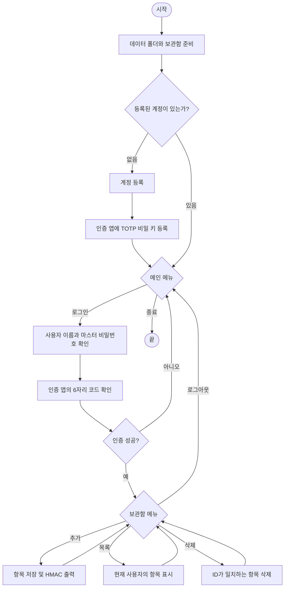

# OpenSSL_PWmanager

고급응용프로그래밍 수업에서 만든 C 기반 CLI 2단계 인증 비밀번호 관리 프로그램입니다. OpenSSL을 이용해 마스터 비밀번호 해시와 TOTP 코드를 계산하고, 인증된 사용자가 로컬 파일에 저장된 비밀번호 항목을 관리합니다.

> [!WARNING]
> 이 프로젝트는 학습 및 시연용입니다. 실제 계정이나 중요한 비밀번호를 저장하지 마세요. 보관함의 비밀번호는 `data/vault.dat`에 평문으로 기록되고, 계정 비밀번호에는 salt 없는 SHA-256을 사용합니다. TOTP 비밀 키도 `data/user.dat`에 평문으로 저장됩니다. 화면에 출력하는 HMAC은 별도 저장하거나 이후 자동 검증하지 않습니다.

## 주요 기능

- 사용자별 계정 등록 및 마스터 비밀번호 확인
- OpenSSL 난수로 TOTP 비밀 키 생성, `otpauth://` 등록 URI 출력
- 인증 앱의 6자리 TOTP 확인 후 보관함 접근
- 비밀번호 항목 추가, 사용자별 목록 조회, 항목 ID로 삭제
- 로그인 및 항목 변경 후 `vault.dat`의 HMAC-SHA256 출력
- 터미널에서 마스터 비밀번호와 항목 비밀번호를 입력할 때 입력 문자 숨김

## 실행 흐름



## 요구 사항

- Linux 또는 POSIX 호환 터미널
- GCC 또는 호환 C 컴파일러
- OpenSSL 개발 라이브러리 및 헤더 (`libssl-dev` 패키지)
- TOTP 등록과 로그인에 사용할 인증 앱

Ubuntu/Debian에서는 다음 명령으로 컴파일 도구와 OpenSSL 개발 파일을 설치할 수 있습니다.

```sh
sudo apt update
sudo apt install build-essential libssl-dev
```

## 컴파일 및 실행

모든 명령은 프로젝트 루트 디렉터리에서 실행합니다. 프로그램은 현재 작업 디렉터리 아래의 `data/`에 파일을 만들기 때문입니다.

```sh
gcc -std=c11 -Wall -Wextra -I. src/*.c -o password-manager -lcrypto
./password-manager
```

`-I.`는 루트에 있는 헤더 파일(`auth.h`, `crypto.h`, `totp.h`, `vault.h`)을 찾기 위한 옵션이고, `-lcrypto`는 OpenSSL 암호화 라이브러리를 연결합니다. 실행 파일 이름은 원하는 값으로 바꿔도 됩니다.

OpenSSL 3.x에서는 현재 사용 중인 HMAC API에 deprecated 경고가 표시될 수 있습니다. 경고를 숨기지 않고 확인하려면 위 명령을 그대로 사용하세요. 경고를 표시하지 않고 빌드하려면 `-Wno-deprecated-declarations`를 추가할 수 있습니다.

Windows용 분기 코드도 일부 포함되어 있지만, 이 README의 설치 및 빌드 명령은 Ubuntu/Debian 기준입니다. Windows에서는 OpenSSL과 호환되는 컴파일러 및 라이브러리 설정이 별도로 필요합니다.

## 사용 방법

1. 처음 실행하면 첫 계정 등록을 안내합니다. 사용자 이름, 마스터 비밀번호, 비밀번호 확인을 입력합니다.
2. 프로그램이 출력하는 TOTP 비밀 키 또는 `otpauth://` URI를 인증 앱에 등록합니다. QR 코드는 생성하지 않습니다. 등록 화면에 표시된 비밀 키는 `data/user.dat`에도 저장됩니다.
3. 이후 실행에서 `1. Login`을 선택하고 사용자 이름과 마스터 비밀번호를 입력한 다음, 인증 앱에 표시된 6자리 코드를 입력합니다. 시간 오차를 고려해 현재 구간과 바로 앞뒤 30초 구간의 코드를 허용합니다.
4. 인증에 성공하면 보관함 메뉴에서 항목을 추가하거나, 목록을 보거나, 항목 ID를 입력해 삭제할 수 있습니다.
5. `4. Log out`을 선택하면 메인 메뉴로 돌아갑니다. 메인 메뉴에서 `3. Exit`를 선택하면 종료합니다.

마스터 비밀번호와 항목 비밀번호는 입력 중 화면에 표시되지 않습니다. 목록 조회에서는 저장된 항목 비밀번호가 그대로 표시됩니다.

## 데이터 파일

첫 실행 시 프로그램은 `data/` 폴더와 `data/vault.dat` 파일을 준비합니다. 계정을 등록하면 `data/user.dat`가 생성됩니다. 이 경로들은 실행 시점의 현재 작업 디렉터리를 기준으로 합니다.

| 파일 | 내용 |
| --- | --- |
| `data/user.dat` | 사용자 이름, 마스터 비밀번호 SHA-256, Base32 TOTP 비밀 키 순서의 계정 레코드 |
| `data/vault.dat` | 항목 ID, 소유자, 서비스, 계정 이름, 비밀번호, 비밀번호 SHA-256 순서의 항목 레코드 |
| `data/vault.tmp` | 항목 삭제 중 임시로 사용하는 파일. 정상 완료 후 제거되거나 `vault.dat`로 교체됩니다. |

`vault.dat`에는 비밀번호 원문이 포함됩니다. SHA-256 필드는 암호화가 아니며, 목록 기능은 원문 비밀번호와 해시를 모두 출력합니다. `vault.dat`의 HMAC은 로그인 마스터 비밀번호를 키로 계산해 화면에 출력하지만, 기준값을 저장하거나 파일을 자동으로 검증하지 않습니다.

## 프로젝트 구조

```text
.
├── src/                 C 구현 파일
│   ├── main.c           메뉴와 프로그램 흐름
│   ├── auth.c           계정 등록 및 마스터 비밀번호 확인
│   ├── totp.c           TOTP 비밀 키·URI·코드 처리
│   ├── crypto.c         SHA-256, HMAC 및 공통 보조 함수
│   └── vault.c          터미널 입출력과 보관함 관리
├── auth.h, crypto.h, totp.h, vault.h
├── data/                실행 시 생성되는 계정 및 보관함 파일
├── 동작 메커니즘.md
├── 시스템 핵심 코드.md
├── 파일별 역할.md
└── Hash_HMAC_TOTP 핵심코드.md
```

자세한 설명은 [동작 메커니즘](동작%20메커니즘.md), [시스템 핵심 코드](시스템%20핵심%20코드.md), [파일별 역할](파일별%20역할.md), [Hash/HMAC/TOTP 핵심 코드](Hash_HMAC_TOTP%20핵심코드.md)를 참고하세요.

## 문제 해결

- `openssl/...: No such file or directory`: OpenSSL 개발 패키지를 설치했는지 확인하세요.
- `undefined reference to ...`: 컴파일 명령 끝에 `-lcrypto`가 있는지 확인하세요.
- 헤더 파일을 찾지 못함: 프로젝트 루트에서 빌드하고 `-I.`를 포함하세요.
- `data/` 파일을 찾지 못함: 프로젝트 루트에서 실행했는지, 쓰기 권한이 있는지 확인하세요.
- 인증 코드가 거부됨: 기기의 시간이 자동으로 동기화되어 있는지 확인한 뒤 새 6자리 코드를 입력하세요.
